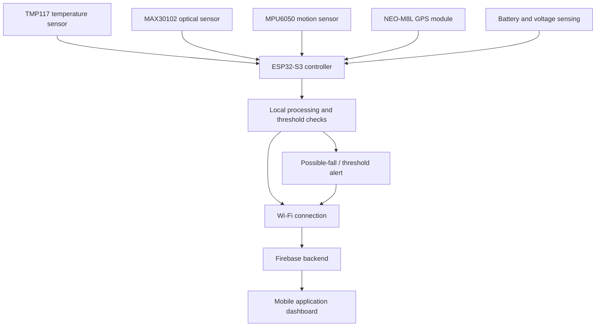

# Smart Band Based IoT Health Monitoring and Emergency Alert System

An ESP32-S3-based wearable prototype for collecting selected health-related sensor readings, detecting possible falls, recording GPS location when available, and sharing monitoring data and alerts through an IoT/cloud-connected mobile application.

> **Project status:** Prototype documentation starter pack. Update the implementation-specific sections against the exact firmware and mobile-app source before publishing.
>
> **Safety notice:** This is an educational engineering prototype, not a medical device. It is not validated for diagnosis, treatment, or emergency decision-making. Sensor readings can be inaccurate, and alerts can be missed or triggered incorrectly. Do not use it as a substitute for clinically validated equipment or emergency services.

## Features

- Temperature readings using a TMP117 sensor.
- Optical heart-rate and SpO₂ estimation using a MAX30102 sensor and an appropriate signal-processing algorithm.
- Motion sensing and possible-fall detection using an MPU6050 (GY-521) module.
- GPS coordinates from a u-blox NEO-M8L module when a valid fix is available.
- Battery-level monitoring, if the hardware includes a correctly designed voltage-sensing circuit.
- Cloud data synchronization and alert presentation through a Firebase-connected mobile app, if configured in the deployed build.
- Periodic sampling; the project has previously been planned around a 30-second or 1-minute interval. Confirm the actual interval in the final firmware.

## System overview



The diagram shows the intended architecture. Confirm that each block and data path is implemented in the version being published.

## Hardware

| Component | Purpose | Interface |
|---|---|---|
| ESP32-S3-DevKitC-1 (N8R2 variant) | Main controller and Wi-Fi connectivity | GPIO, I²C, UART |
| TMP117 | Digital temperature measurement | I²C |
| MAX30102 | Optical pulse signal used to estimate heart rate and SpO₂ | I²C |
| GY-521 / MPU6050 | Accelerometer and gyroscope data for possible-fall detection | I²C |
| u-blox NEO-M8L-01A-81 | GPS position and navigation data | UART |
| KP-523450 rechargeable LiPo cell | Portable power source | Power circuit |
| TP4056 charging module | Li-ion/LiPo charging | Battery charging circuit |
| Battery voltage divider and ADC input | Optional battery-level estimate | ADC |

**Important:** A MAX30102 does not directly measure blood pressure. Blood pressure is not included as a validated measurement in this documented design. Wrist skin temperature is not the same as core body temperature.

## Repository layout

```text
SmartBand_GitHub_Documentation/
├── README.md
├── LICENSE_CHOOSE.txt
├── CONTRIBUTING.md
├── SECURITY.md
├── docs/
│   ├── architecture.md
│   ├── hardware-and-wiring.md
│   ├── firmware-guide.md
│   ├── firebase-and-mobile-app.md
│   ├── testing-and-validation.md
│   ├── troubleshooting.md
│   └── privacy-and-safety.md
├── hardware/
│   └── BOM.md
├── firmware/
│   └── README.md
├── mobile-app/
│   └── README.md
└── assets/
    └── README.md
```

## Getting started

1. Assemble the sensor modules and ESP32-S3 only after verifying the exact development-board pinout and module voltage requirements.
2. Install Arduino IDE and the ESP32 board package.
3. Install the libraries listed in [Firmware guide](docs/firmware-guide.md).
4. Add the final firmware source to `firmware/` and update its configuration instructions.
5. Configure Firebase using the instructions in [Firebase and mobile app](docs/firebase-and-mobile-app.md). Do not commit private credentials, access tokens, service-account keys, or real user health data.
6. Add the actual mobile-app source to `mobile-app/` or link to its separate repository.
7. Follow the test checklist in [Testing and validation](docs/testing-and-validation.md).

## Hardware pin plan

The following is the pin plan discussed during development. **Verify every connection against your exact ESP32-S3 board revision and the modules you own before powering the circuit.**

| Signal | ESP32-S3 GPIO | Notes |
|---|---:|---|
| Shared I²C SDA | GPIO 8 | TMP117, MAX30102, MPU6050 share the bus if addresses do not conflict |
| Shared I²C SCL | GPIO 9 | Verify GPIO availability and board wiring |
| GPS UART RX (ESP receives GPS TX) | GPIO 2 | UART input; check module baud rate |
| GPS UART TX (ESP sends to GPS RX) | GPIO 1 | UART output; check module logic levels |

Expected common I²C addresses, subject to breakout configuration:
- TMP117: commonly `0x48`
- MAX30102: commonly `0x57`
- MPU6050: commonly `0x68` (or `0x69` depending on AD0)

Do not connect sensor modules by address assumptions alone; use an I²C scanner and the module documentation.

## Configuration and secrets

Keep credentials in a local configuration file that is excluded from Git, or use a supported secret/configuration mechanism. Never publish:
- Wi-Fi passwords
- Firebase private keys or service-account JSON
- Access tokens or API secrets
- Personal phone numbers, private GPS tracks, or real health records

A Firebase project ID and Android app ID are identifiers, not a replacement for the configuration and security rules required by your app.

## Limitations

- Optical heart-rate and SpO₂ estimates depend on sensor placement, motion, skin contact, ambient light, and algorithm quality.
- The MPU6050 can indicate motion patterns consistent with a fall but cannot prove that a person has fallen.
- GPS may not obtain a fix indoors or in obstructed environments.
- Battery life depends on the complete board, sensor configuration, GPS duty cycle, Wi-Fi use, display/LED activity, and battery condition. Measure current on the actual build.
- Cloud updates and alerts require network availability and correct backend/app configuration.
- No medicine recommendation or diagnosis should be generated from these readings.

## Documentation

- [Architecture](docs/architecture.md)
- [Hardware and wiring](docs/hardware-and-wiring.md)
- [Bill of materials](hardware/BOM.md)
- [Firmware guide](docs/firmware-guide.md)
- [Firebase and mobile app](docs/firebase-and-mobile-app.md)
- [Testing and validation](docs/testing-and-validation.md)
- [Troubleshooting](docs/troubleshooting.md)
- [Privacy and safety](docs/privacy-and-safety.md)

## Acknowledgements

This project brings together embedded systems, sensors, wireless connectivity, cloud data handling, and mobile-app development for an educational wearable-monitoring prototype. Add any libraries, tutorials, datasheets, and third-party projects used in your implementation to a references section before publishing.

## License

Choose a license before making the repository public. See `LICENSE_CHOOSE.txt`. Do not assume that source code or assets from third parties can be relicensed.

## Device


## VITALBAND APP


